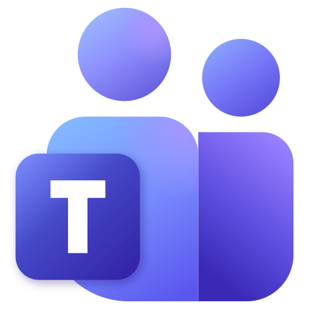

<div align="center">



# Teams for Ubuntu

A fast, hardened Microsoft Teams desktop app for Ubuntu Linux.

[](https://github.com/asmsaiff/teams-desktop/releases/latest)
[](https://github.com/asmsaiff/teams-desktop/actions/workflows/ci.yml)
[](LICENSE)

</div>

Microsoft no longer ships a native Teams app for Linux. This app runs the official
Teams web client inside a locked-down Chromium shell (Electron). It adds a square,
frameless window that remembers its size, faster start-up, and strict security
defaults.

## Install

### Ubuntu / Debian (.deb, recommended)

1. Open the [latest release](https://github.com/asmsaiff/teams-desktop/releases/latest).
2. Download `teams-desktop_<version>_amd64.deb`.
3. Install it:

```bash
sudo apt install ./teams-desktop_*_amd64.deb
```

Launch **Microsoft Teams** from the app grid, or run `teams-desktop` in a terminal.
The `.deb` also installs the AppArmor profile that keeps Chromium's sandbox working
on Ubuntu 24.04 and newer.

**Update:** install the newer `.deb` the same way. Your sign-in and settings are kept.

**Uninstall:**

```bash
sudo apt remove teams-desktop
```

### AppImage (portable, any distribution)

Download `Teams-<version>-x86_64.AppImage` from the
[latest release](https://github.com/asmsaiff/teams-desktop/releases/latest). Make it
executable and run it:

```bash
chmod +x Teams-*-x86_64.AppImage
```

```bash
./Teams-*-x86_64.AppImage
```

### Verify your download (optional)

Each release includes `SHA256SUMS.txt` and a signed build-provenance attestation:

```bash
sha256sum -c SHA256SUMS.txt --ignore-missing
```

```bash
gh attestation verify teams-desktop_*_amd64.deb --repo asmsaiff/teams-desktop
```

## Requirements

- Ubuntu 24.04 or newer, x86_64 (22.04 and other recent Debian-based distributions should also work)
- X11 or Wayland
- A system keyring (GNOME Keyring, installed on Ubuntu by default) to encrypt cookies
- For the tray icon on GNOME: the AppIndicator extension (enabled on Ubuntu by default)

## Features

| | |
| --- | --- |
| **Square window** | Frameless, no rounded corners, slim custom title bar |
| **Remembers its window** | Size, position (X11), maximized state and zoom are restored on the next launch. If a monitor is unplugged, the window moves back onto a visible screen. |
| **Fast start** | The Teams page starts loading before the rest of the window is built. Connections to Teams and sign-in are opened in advance, and the cache persists between launches. |
| **Runs in the tray** | Closing the window keeps Teams running for calls and notifications |
| **Unread badge** | On the title bar and dock icon |
| **Screen sharing** | Source picker on X11; the system portal picker on Wayland |
| **Meeting links** | `msteams:` links from calendar invites open in the app |
| **Right-click menu** | Spell-check, copy/paste, open links in your browser |
| **Self-healing** | Reloads automatically if the page crashes |

### Keyboard shortcuts

| Keys | Action |
| --- | --- |
| <kbd>Ctrl</kbd> + <kbd>=</kbd> / <kbd>-</kbd> / <kbd>0</kbd> | Zoom in / out / reset (remembered) |
| <kbd>F11</kbd> | Full screen |
| <kbd>F5</kbd> or <kbd>Ctrl</kbd> + <kbd>Shift</kbd> + <kbd>R</kbd> | Reload |
| <kbd>Ctrl</kbd> + <kbd>Q</kbd> | Quit |

## Security

- **Isolated web content**: Teams runs sandboxed with `contextIsolation`, no Node.js
  access, and no scripts injected into the page.
- **Chromium sandbox stays on**: the `.deb` installs an AppArmor profile instead of
  falling back to `--no-sandbox`.
- **Microsoft-only navigation**: only Microsoft domains can load inside the app. Other
  links open in your default browser. Plain `http://` requests are blocked.
- **Company sign-in**: if sign-in redirects to your organisation's own single sign-on
  server, the app asks before allowing it (once or always).
- **Permissions gate**: microphone, camera, notifications and screen capture are
  granted only to Microsoft origins. Location, USB, HID, serial, MIDI and similar are
  always refused.
- **No hidden windows or webviews**: `<webview>` is disabled, and popups get the same
  restrictions as the main window.
- **Private local UI**: the title bar and screen picker are served from an `app://`
  scheme that Teams pages can't reach, with a strict Content-Security-Policy and
  sender-checked IPC.
- **Electron fuses**: the binary ignores `ELECTRON_RUN_AS_NODE`, `NODE_OPTIONS` and
  `--inspect`, and loads code only from `app.asar`.
- **Encrypted cookies**: your session cookies are encrypted with the system keyring.
- **Anti-session-theft**: release builds refuse to start with remote-debugging
  switches, and DevTools are disabled.
- **No fingerprinting**: the user agent is plain Chrome, with no app name or Electron
  version.
- **Private settings files**: written atomically with `0600` permissions.
- **Supply chain**: GitHub Actions are pinned to commit hashes. Releases are built in
  CI from tagged commits and ship with checksums and provenance attestations.
  Dependabot keeps Electron, and so Chromium, up to date.

Found a security problem? Please report it privately through
[GitHub security advisories](https://github.com/asmsaiff/teams-desktop/security/advisories/new)
rather than in a public issue.

## Configuration

`~/.config/teams-desktop/config.json` is created on first run:

```json
{
  "url": "https://teams.microsoft.com/v2/",
  "closeToTray": true,
  "startHidden": false,
  "titleBarHeight": 30,
  "allowedDomains": [],
  "spellcheckLanguages": ["en-US"],
  "hardwareAcceleration": true
}
```

| Setting | Description |
| --- | --- |
| `url` | Teams address. Use `https://teams.live.com/` for personal (non-work) accounts. |
| `closeToTray` | Keep running in the tray when the window is closed. |
| `startHidden` | Start in the tray. Useful with autostart. |
| `titleBarHeight` | Title bar height in pixels (24–48). |
| `allowedDomains` | Extra sign-on hosts allowed to load in the app, e.g. `["sso.example.com"]`. |
| `spellcheckLanguages` | Spell-check languages, e.g. `["en-US", "de-DE"]`. |
| `hardwareAcceleration` | Set to `false` if you see graphics glitches. |

Restart the app after editing. The window size is stored in
`~/.config/teams-desktop/window-state.json`; delete that file to reset the window.

## Troubleshooting

**Blank window, or "sandbox" errors when launching the AppImage on Ubuntu 24.04+.**
Ubuntu restricts the kernel feature Chromium's sandbox uses. Install the `.deb`
instead: it adds the required AppArmor profile.

**Sign-in keeps asking for my company's sign-on page.** Choose **Always allow** in the
prompt, or add the host to `allowedDomains`.

**No tray icon.** Enable the *Ubuntu AppIndicators* GNOME extension, or set
`"closeToTray": false` so closing the window quits the app.

**Reset everything (sign out and clear the cache):**

```bash
rm -rf ~/.config/teams-desktop
```

## Development

Requires Node.js 22.12 or newer.

```bash
git clone https://github.com/asmsaiff/teams-desktop.git
cd teams-desktop
npm ci
```

| Command | What it does |
| --- | --- |
| `npm start` | Run from source |
| `npm run dev` | Run with DevTools (<kbd>Ctrl</kbd>+<kbd>Shift</kbd>+<kbd>I</kbd>) and "Inspect element" |
| `npm run check` | Syntax-check all sources |
| `npm run icons` | Re-render all PNG icons from `src/assets/icon.svg` |
| `npm run dist` | Build `dist/*.deb` and `dist/*.AppImage` |

### Project layout

```
src/main/        main process: window, security, window state, screen share, menus
src/preload/     minimal bridges for the title bar and screen picker only
src/renderer/    title bar and screen-share picker UI
src/assets/      icon.svg (source of every icon)
scripts/         icon rendering, release notes
.github/         CI, release workflow, Dependabot
electron-builder.yml   packaging, Electron fuses, .deb dependencies
```

### Releasing

See [RELEASE.md](RELEASE.md). In short: update `CHANGELOG.md`, run `npm version
minor`, then `git push --follow-tags`. GitHub Actions builds and publishes the release.

## License

[MIT](LICENSE). Microsoft Teams and the Teams logo are trademarks of Microsoft
Corporation. This is an unofficial client and is not affiliated with or endorsed by
Microsoft.
